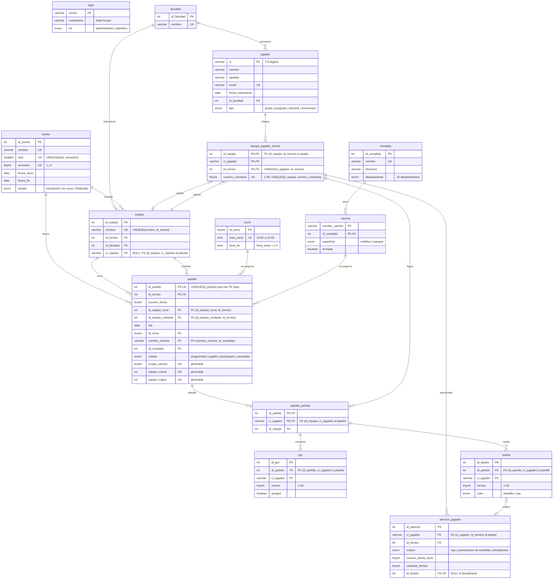

# Diagrama entidad-relación

Sale de `db/init/01_schema.sql`. GitHub muestra el bloque Mermaid como diagrama.

`PK` es clave primaria, `FK` clave foránea y `UK` indica que la columna está en un UNIQUE.
En `partido`, `ocupa_cancha`, `equipo_menor` y `equipo_mayor` son columnas generadas (ADR 0006).

## Relaciones que conviene mirar dos veces
El plantel apunta a `equipo` por `(id_equipo, id_torneo)`, así que su `id_torneo` no puede ser distinto del del equipo.
El equipo, a su vez, apunta al plantel por `(id_equipo, ci_capitan)`: es una relación circular, y garantiza que el
capitán juegue en su propio equipo.

El partido apunta a `equipo` con `(id_equipo_local, id_torneo)` y `(id_equipo_visitante, id_torneo)`, por lo que los
dos equipos son de la edición del partido.

La planilla apunta al plantel por `(id_equipo, ci_jugador)`, y gol y tarjeta apuntan a la planilla por
`(id_partido, ci_jugador)`. La sanción apunta al plantel por `(ci_jugador, id_torneo)`, así que solo se sanciona a
inscriptos de esa edición.

`login` no se relaciona con ninguna tabla (ADR 0008).
